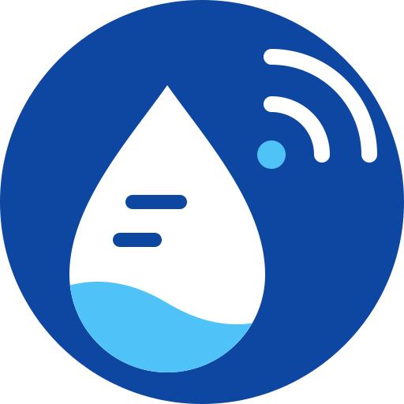
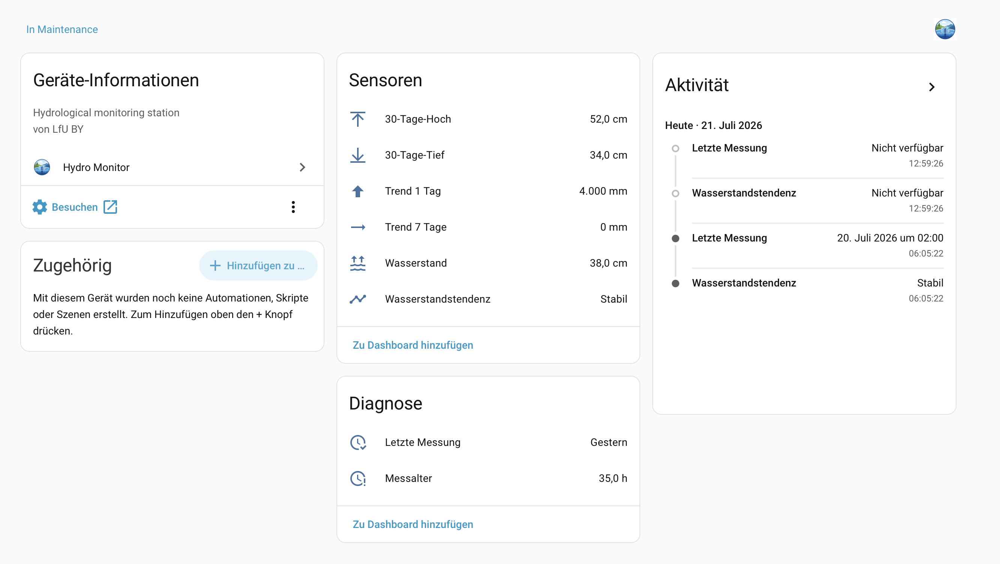
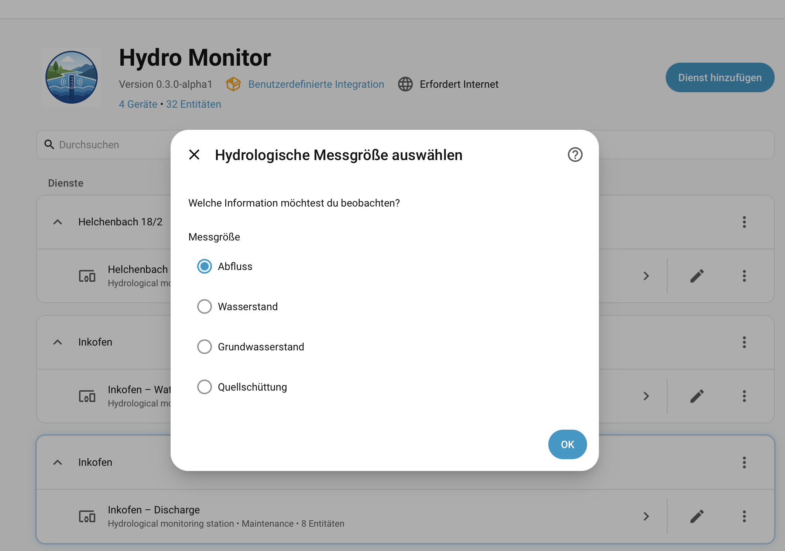

# Hydro Monitor

  
  
  
  
  
  

  

A modern Home Assistant integration for monitoring groundwater levels and other hydrological measurements from public data providers. **Currently available for Germany only.**

- 📍 Automatic station discovery
- 🌍 Uses your Home Assistant location to find the nearest stations
- 🇩🇪 Germany only for now (data from NIWIS and PEGELONLINE)
- 📈 Trend analysis
- 🩺 Diagnostics & System Health
- 🌐 English & German
- ✅ Available in HACS (default repository)

  <strong>Hydrological monitoring for Home Assistant.</strong>

Hydro Monitor is a custom Home Assistant integration for public hydrological data. It is designed to help users discover nearby monitoring stations automatically and add groundwater, water-level, river-discharge, and spring-discharge data without having to know provider-specific station IDs.

> [!IMPORTANT]
> **Hydro Monitor currently covers Germany only.** It has two data providers: NIWIS (Niedrigwasserinformationssystem of the Bundesanstalt für Gewässerkunde), which publishes monitoring stations in nearly all German federal states and on the federal waterways, and PEGELONLINE of the federal waterways and shipping administration (WSV), which adds the water level and discharge gauges of the federal waterways, including Hamburg. There are no stations outside Germany yet apart from a few gauges on border waters, so if your Home Assistant is located elsewhere the integration will not be useful to you for now. Support for further providers is planned, and Hydro Monitor is under active development.

> [!NOTE]
> **Current status:** Beta (`v0.3.1`) – recommended for general use; feedback still welcome.

## Features

- Native Home Assistant integration
- Two data providers in one station list: NIWIS and PEGELONLINE
- Automatic station discovery based on your Home Assistant location
- Manual station search by name, across all stations nationwide
- Groundwater level monitoring
- Water level monitoring
- River discharge monitoring
- Spring discharge monitoring
- 1-day trend sensor
- 7-day trend sensor
- Water level trend (enum)
- 30-day minimum and maximum sensors
- Last observation timestamp
- Measurement age sensor
- Official NIWIS low-water classification (enum)
- Official NIWIS static and dynamic low-water classification boundaries
- Official NIWIS decile boundaries (P0-P100) for discharge and water level
- Official NIWIS 7-day development assessment for discharge and water level
- Official NIWIS historical statistics: MQ, MNQ, NM7Q, NM30Q, NQ, Median Q, SumD, SumV (discharge), MW, MNW, NW, Median W (water level)
- Official NIWIS historical calendar-day envelope: min/median/max discharge and median water level for today's exact calendar day, reference period 1991-2020
- Official NIWIS waterway navigation indicators (below GlW, days below GlW/RWN/BWu) for federal waterway gauges
- Official NIWIS groundwater depth below ground surface (Flurabstand)
- `%`-of-mean comparison sensors (current value vs. MQ/MNQ/MW/MNW)
- Plain-language glossary attribute on every official NIWIS sensor, explaining its abbreviation in your configured language
- Example Lovelace dashboards (English and German) for every measurement type, including historical range comparison in the history graph
- Built-in diagnostics download
- Home Assistant System Health support
- English and German translations
- HACS-compatible repository structure
- Automatic updates via DataUpdateCoordinator

## Vision

Hydro Monitor should become the central hydrological data integration for Home Assistant, automatically selecting the most appropriate public data provider.

## Current status

**Current release:** `v0.3.1`

Hydro Monitor currently supports two public hydrological data services, which cover Germany: NIWIS and PEGELONLINE.

The architecture is provider-based and designed to support additional national and regional hydrological services without requiring changes to the Home Assistant integration itself.

## Supported providers

| Provider | Coverage | Status | Data |
|---|---|---|---|
| NIWIS | Germany (nearly all federal states and the federal waterways) | Beta | Groundwater level, water level, discharge, spring discharge (daily values, official low-water classification and statistics) |
| PEGELONLINE | Germany's federal waterways, including Hamburg and the tidal gauges | Beta | Water level and discharge every 15 minutes (some gauges every minute), position against mean low and high water |

Additional providers may be added later without changing the core integration architecture.

## Preview

## Dashboard examples

Copy-paste Lovelace dashboard examples (single-station overview,
multi-station comparison with a map view) are available in
[`docs/examples`](docs/examples). These are documentation only, not part of
the integration.

## Automation blueprints

Copy-paste Home Assistant automation blueprints (notify on a low-water
class change, notify when a station's data goes stale) are available in
[`blueprints`](blueprints). These are documentation only, not part of the
integration.

## Installation

### HACS

Hydro Monitor is part of the HACS default repository list, so no custom repository is needed.

1. Open **HACS** and search for **Hydro Monitor** (or use the button above).
2. Open it and select **Download**.
3. Restart Home Assistant.

## Configuration

After installation:

1. Open **Settings → Devices & Services**.
2. Add **Hydro Monitor**.
3. Select the desired measurement type.
4. Hydro Monitor automatically discovers the nearest monitoring stations of all data providers using your Home Assistant location, as one list sorted by distance. Each entry names its source. Stations exist in Germany only, so outside Germany the nearest one is far away.
5. Select a station.
6. The integration creates all available sensors automatically.

### NIWIS or PEGELONLINE?

Many gauges on the federal waterways (for example Kaub on the Rhine) are in both services and appear twice in the list, once per source. You can add both.

| | NIWIS | PEGELONLINE |
|---|---|---|
| Values | Daily | Every 15 minutes (some gauges every minute) |
| Stations | Federal states' networks and federal waterways; groundwater and springs | Federal waterways only; water level and discharge |
| Official low-water class, deciles, reference statistics (MQ, NM7Q, ...) | Yes | No |
| Position against mean low / high water | No | Yes (`Water level vs. mean low/high`) |

PEGELONLINE entries get only the sensors a raw measurement series can fill: the value, the trends, the 30-day low and high, the age of the measurement and the position against mean low and high water. On PEGELONLINE entries the trends compare the mean of the last 24 hours with the mean of the day (week) before, so the tide of tidal gauges (Elbe, Weser, Ems, coast) does not drown them; the 30-day low and high are the raw extremes and show the full tidal range.

## Available Sensors

| Sensor | Description |
|---------|-------------|
| Current value | Latest measurement |
| 1-day trend | Difference to the previous day |
| 7-day trend | Difference to the previous week |
| Water level trend | Rising / Stable / Falling |
| 30-day minimum | Lowest value during the last 30 days |
| 30-day maximum | Highest value during the last 30 days |
| Last observation | Timestamp of the latest observation |
| Measurement age | Hours since the latest observation |
| Low-water class | NIWIS's own current low-water classification (NIWIS only) |
| Water level vs. mean low/high | PEGELONLINE's own classification of the water level: low (at or below mean low water), normal, high (at or above mean high water) (PEGELONLINE water level only) |
| Official 7-day development | NIWIS's own assessment of the last 7 days (discharge, water level) |
| MQ / MNQ | Mean discharge / mean of the annual lowest discharge, reference period 1991-2020 (discharge) |
| MW / MNW | Mean water level / mean of the annual lowest water level, reference period 1991-2020 (water level) |
| % of MQ / MNQ / MW / MNW | Current value as a percentage of the corresponding reference-period mean |
| Depth below ground surface | Groundwater depth below the ground surface (Flurabstand), from NIWIS directly (groundwater) |

These are also official NIWIS-calculated statistics, enabled by default
alongside the sensors above: usually available and broadly useful for
their measurement type, so they're on the default device page rather than
tucked away in the entity list.

The following sensors are further official NIWIS-calculated statistics.
They are disabled by default (enable them individually in the entity
list) to keep the default device page focused on the everyday values and
the sensors above — these are more niche, redundant with a sensor already
shown above, or only meaningful for a subset of stations. Every one of
these also carries a plain-language explanation in its "more info" dialog
(`description` attribute, in your Home Assistant language) since the
abbreviations below mirror NIWIS's own hydrological terminology and aren't
self-explanatory at a glance:

| Sensor | Description |
|---------|-------------|
| Static low-water boundaries | Fixed classification thresholds (extremely low / very low / low), unchanged all year |
| Dynamic low-water boundaries | Classification thresholds adjusted for today's calendar day |
| Decile boundaries (P0-P100) | 11-point decile distribution for today's calendar day, reference period 1991-2020 |
| NM7Q / NM30Q | Lowest 7-day / 30-day mean discharge within the last 30 days (with the date range it occurred in) |
| NQ / Median Q | Lowest / median discharge across the reference period |
| NW / Median W | Lowest / median water level across the reference period |
| Historical min/median/max Q for today | The lowest, typical, and highest discharge ever recorded on this exact calendar day, reference period 1991-2020 |
| Historical median W for today | The typical water level ever recorded on this exact calendar day |
| Low-water days (30d) / deficit volume (30d) | Number of low-water days, and accumulated discharge deficit volume, within the last 30 days (discharge only) |
| Below GlW / Days below GlW-RWN-BWu | Whether the water level is below the waterway navigation reference level, and for how many consecutive days (federal waterway gauges only) |

## Diagnostics

Hydro Monitor supports Home Assistant's built-in diagnostics framework.

Diagnostics can be downloaded directly from the integration page while excluding sensitive location information.

## System Health

Hydro Monitor integrates with Home Assistant System Health and reports:

- configured stations
- providers
- update interval
- coordinator status
- latest observation

## Architecture

Hydro Monitor follows the native Home Assistant architecture:

- Config Flow
- DataUpdateCoordinator
- Translation keys
- Diagnostics
- System Health
- Provider abstraction
- Config Entry Diagnostics

The provider abstraction allows adding additional hydrological services without modifying the Home Assistant integration itself.

## Contributing

Contributions, ideas, bug reports and pull requests are welcome.

Please open a GitHub Issue before submitting larger feature changes or architectural modifications.

## Support

If Hydro Monitor is useful to you, consider supporting its development:
[buymeacoffee.com/JJack640](https://buymeacoffee.com/JJack640).
